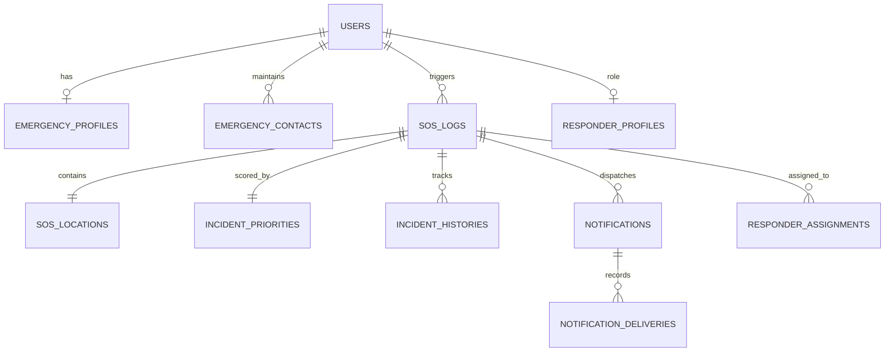

# AegisNet PostgreSQL Database Architecture & Schema

**Engine**: PostgreSQL 16  
**Database**: `aegisnet`  
**Host**: `localhost:5432`  

The relational schema implements 13 normalized tables with foreign keys, constraints, and audit logging.

---

## Table Definitions

### 1. `users`
- `id`: SERIAL PRIMARY KEY
- `name`: VARCHAR(255) NOT NULL
- `email`: VARCHAR(255) UNIQUE NOT NULL
- `password_hash`: VARCHAR(255) NOT NULL
- `phone`: VARCHAR(50)
- `role`: VARCHAR(30) DEFAULT 'user' (user, responder, admin)
- `status`: VARCHAR(30) DEFAULT 'active'
- `created_at`, `updated_at`: TIMESTAMP

### 2. `emergency_profiles`
- `id`: SERIAL PRIMARY KEY
- `user_id`: INTEGER UNIQUE REFERENCES users(id) ON DELETE CASCADE
- `blood_group`: VARCHAR(10)
- `allergies`: TEXT
- `medications`: TEXT
- `medical_notes`: TEXT
- `emergency_instructions`: TEXT

### 3. `emergency_contacts` (Max 5 per user)
- `id`: SERIAL PRIMARY KEY
- `user_id`: INTEGER REFERENCES users(id) ON DELETE CASCADE
- `name`: VARCHAR(255) NOT NULL
- `phone`: VARCHAR(50) NOT NULL
- `relationship`: VARCHAR(50) NOT NULL
- `priority`: INTEGER CHECK (priority BETWEEN 1 AND 5)
- UNIQUE(user_id, phone)

### 4. `sos_logs`
- `id`: SERIAL PRIMARY KEY
- `incident_code`: VARCHAR(50) UNIQUE NOT NULL (e.g. `SOS-2026-70236`)
- `user_id`: INTEGER REFERENCES users(id)
- `incident_type`: VARCHAR(100) NOT NULL
- `description`: TEXT
- `priority`: VARCHAR(30) DEFAULT 'Critical'
- `status`: VARCHAR(50) DEFAULT 'Triggered'
- `idempotency_key`: VARCHAR(100) UNIQUE
- `created_at`, `updated_at`: TIMESTAMP

### 5. `sos_locations`
- `id`: SERIAL PRIMARY KEY
- `sos_id`: INTEGER UNIQUE REFERENCES sos_logs(id) ON DELETE CASCADE
- `latitude`: DECIMAL(10, 7)
- `longitude`: DECIMAL(10, 7)
- `altitude`: DECIMAL(8, 2)
- `accuracy`: DECIMAL(8, 2)
- `heading`, `speed`: DECIMAL(8, 2)
- `location_text`: VARCHAR(255)
- `google_maps_url`: TEXT NOT NULL

### 6. `incident_priorities`
- `id`: SERIAL PRIMARY KEY
- `sos_id`: INTEGER UNIQUE REFERENCES sos_logs(id) ON DELETE CASCADE
- `calculated_score`: INTEGER CHECK (calculated_score BETWEEN 0 AND 100)
- `priority_level`: VARCHAR(30) NOT NULL
- `ai_confidence`: VARCHAR(20)
- `explanation`: TEXT
- `factors`: JSONB

### 7. `incident_histories`
- `id`: SERIAL PRIMARY KEY
- `sos_id`: INTEGER REFERENCES sos_logs(id) ON DELETE CASCADE
- `status`: VARCHAR(50) NOT NULL
- `notes`: TEXT
- `changed_by`: INTEGER REFERENCES users(id)
- `timestamp`: TIMESTAMP DEFAULT CURRENT_TIMESTAMP

### 8. `notifications` & `notification_deliveries`
- Track SMS delivery attempts, recipient phone numbers, provider tag (`[SIMULATED SMS - DEV PROVIDER]` or Twilio), status, and retry timestamps.

### 9. `responder_profiles` & `responder_assignments`
- Manage dispatch units, agency designations, assigned incidents, and active deployment statuses.

### 10. `offline_sync_records` & `audit_logs`
- Manage idempotent batch event recovery from client device offline queues and system telemetry.
